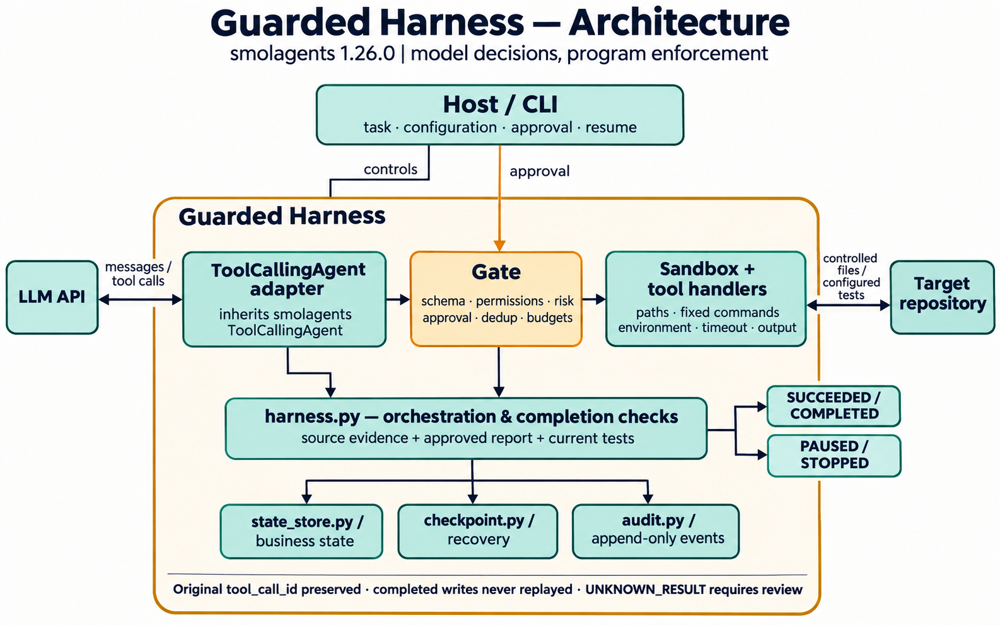
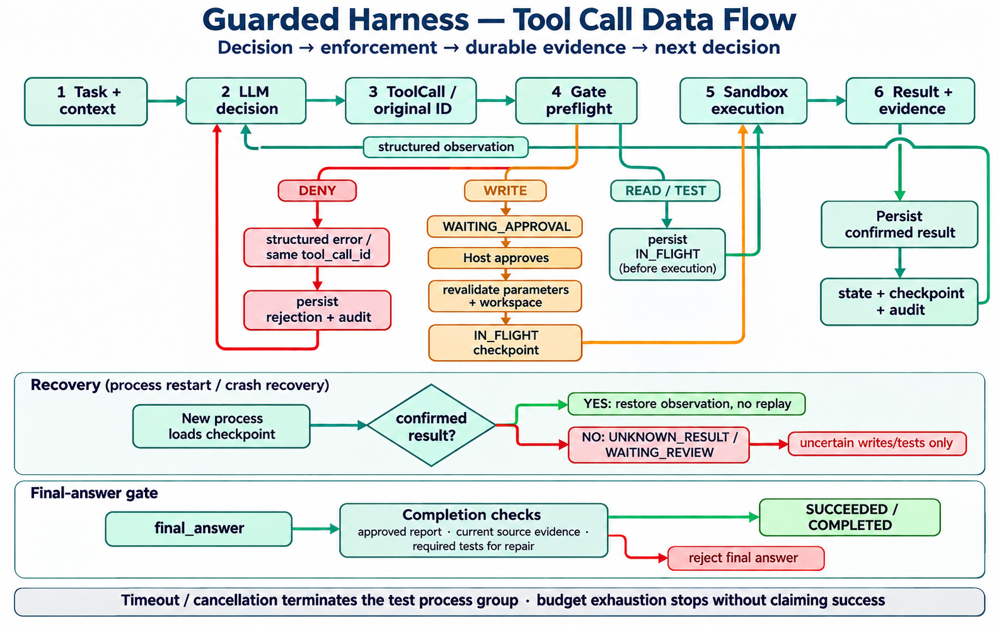

# Guarded Harness

基于 **smolagents 1.26.0** 的可恢复仓库任务控制器，支持代码理解与测试修复。用户提供仓库和自然语言任务，模型选择工具和下一步动作；程序负责权限、审批、执行边界、持久化、审计、恢复与最终验收。

正式入口连接真实模型。FakeModel 和预设响应仅用于离线测试，不参与实际任务决策。

## 架构与责任边界



六个核心模块保留在 `src/guarded_harness/`，不修改 smolagents 核心源码：

| 模块 | 负责什么 | 关键边界 |
| --- | --- | --- |
| `harness.py` | 模型和工具装配、CLI、Agent 适配、计划、审批交互、运行和最终验收 | `Harness.run()` / `resume()` 是任务执行入口；模型提出动作，程序确定状态 |
| `gate.py` | 参数、权限、风险、审批、重复动作、调用预算与统一分发 | 所有模型工具调用都经过 `Gate.dispatch()`，拒绝返回原 `tool_call_id` |
| `sandbox.py` | 路径和真实落点、敏感目录、受控写入、固定测试命令、环境、超时和输出限制 | 前置检查后，实际执行时再次检查；超时和取消终止测试进程组 |
| `state_store.py` | Run、计划、步骤、证据、预算、审批、动作结果和停止原因 | 临时文件同步后原子替换，保存完整业务状态 |
| `checkpoint.py` | 读取权威检查点，识别未确认执行结果 | 已确认写入不重放；不确定写入或测试进入 `UNKNOWN_RESULT` |
| `audit.py` | 追加记录规则、决定、操作者、审批及执行结果 | 通过 `run_id`、`tool_call_id` / `toolCallId` 还原调用链 |

`_GuardedToolCallingAgent` 继承框架的 `ToolCallingAgent`，适配原始调用 ID、顺序工具分发、暂停、上下文及步骤保存。模型生成与基础 Agent 循环继续使用 smolagents。

### 一次请求如何执行



1. **任务进入。** CLI 读取宿主配置；Harness 创建业务状态、初始计划、工作区指纹与运行目录。
2. **模型决策。** 将任务、当前计划、近期完整动作及证据摘要发送给模型，获得带原始 ID 的工具调用。
3. **门禁校验。** Gate 检查参数、工具注册、风险、预算、重复动作和 Sandbox 前置边界。拒绝会先持久化，再返回结构化错误，handler 不执行。
4. **审批写入。** 源码修改及报告写入进入 `WAITING_APPROVAL`。宿主审阅准确内容或 Diff；审批绑定调用 ID、参数签名和工作区版本。
5. **受控执行。** 获批后再次校验，先保存 `IN_FLIGHT` 意图，再调用 handler。Sandbox 执行文件操作或宿主注册的测试命令。
6. **保存证据。** 持久化结果、版本和检查点，追加审计，将结构化观察交回模型，继续下一轮决策。
7. **最终验收。** `final_answer` 必须经过程序检查。模型说“完成”不能直接设置成功状态。

读取不需要写入审批；测试仅执行宿主已注册的固定命令。发现工具的搜索结果不能替代源码读取证据。

### 计划、上下文和完成条件

初始计划由 Harness 生成，模型可通过 `update_plan` 修订和推进。计划版本、游标、状态和证据一起保存，恢复后注入模型上下文。计划进度不授予权限，也不能替代测试或交付物。

上下文保留近期完整动作组，并补充任务、计划与证据摘要；原始业务历史仍保存在状态和审计中。无法容纳最新结果时，以 `CONTEXT_LIMIT` 停止。

| 任务类型 | 完成条件 |
| --- | --- |
| `understand` | 有当前源码的实际读取证据、已审批且哈希有效的报告，以及引用源码的最终答复；不开放源码写入 |
| `repair` | 初始真实失败基线、获批源码变更、修改后源码读取、当前版本全部必测通过、已审批报告与最终答复 |

报告内容的语义正确性仍需人工审阅。程序检查报告存在、审批、哈希、源码及测试关联，不逐字判断所有自然语言结论。

## 安装

要求 Python 3.10+，以及 POSIX 文件描述符、文件锁和进程组支持。在项目根目录执行：

```bash
python3 -m venv .venv
source .venv/bin/activate
python -m pip install -e '.[test]' -c configs/validation-constraints.txt
```

上面的安装从包依赖获取 smolagents。已有相邻源码目录时，可改用本地 editable 安装：

```bash
python -m pip install -e ../smolagents -e '.[test]' -c configs/validation-constraints.txt
```

验证约束固定 `smolagents==1.26.0`、`pytest==7.4.4`、`requests==2.34.2`、`python-dotenv==0.21.0`，与本次发布回归环境一致；其他依赖由 `pyproject.toml` 声明。发布时的实际版本保存在证据的 `environment.json` 中。

真实模型凭据通过 `DEEPSEEK_API_KEY` 提供。也可以用 `--env-file /path/to/local.env` 显式加载本机环境文件。配置和检查点只保存认证变量名，不保存密钥值。任务、获准读取的源码和工具记录会发送至配置的模型服务，应选择适合该仓库的数据处理范围。

## 使用自己的仓库

`guarded-harness` 等价于 `python -m guarded_harness.harness`。以下路径是占位符，需要替换为实际路径：

```bash
guarded-harness run \
  --workspace /path/to/target-repo \
  --run-dir /path/to/results/understand-run \
  --backend deepseek \
  --task-kind understand \
  --task '分析项目入口、核心模块和调用关系，并引用实际源码' \
  --max-steps 60 --max-tool-calls 240 --model-max-tokens 4096 \
  --interactive
```

`--workspace` 是被分析或修复的仓库；`--run-dir` 是新建结果目录，必须位于目标仓库之外。未指定结果目录时，默认使用目标仓库父目录的 `.guarded-harness-runs/<随机标识>`。已有任务用 `resume` 继续。

终端显示步骤和工具名。写入前审阅内容：`y` 批准，`n` 拒绝，`r` 退回报告并提供反馈，`q` 暂停。EOF 保留待审批状态。

### 配置测试修复任务

`configs/local.json` 提供 `understand` 和 `repair-python` 两个 profile。复制到目标仓库之外编辑，配置是宿主权限边界，不能让目标仓库自行扩大权限。

| 配置 | 含义 |
| --- | --- |
| `write_paths` | 精确文件白名单，适合根目录文件 |
| `write_directories` | 已存在的相对子目录；拒绝根目录、软链接、敏感目录，不使用通配符 |
| `test_commands` | 名称到固定 argv 的映射；模型只能选择名称，不能提供任意命令或追加参数 |
| `required_tests` | 当前版本完成前必须通过的测试名称 |
| `max_steps` / `max_tool_calls` | 累计步数与工具调用次数上限 |
| `model_max_tokens` | 单次模型生成的输出上限，包括工具参数和报告正文 |
| `context_chars` | 发给模型的消息字符预算；不等于精确 token 计费预算 |

例如，目标源码为根目录的 `calculator.py`：修改 `repair-python` 中的以下字段，保留其他配置和外层 `profiles`：

```json
"write_directories": [],
"write_paths": ["calculator.py"],
"test_commands": {
  "unit": ["@python", "-m", "pytest", "-vv", "-p", "no:cacheprovider", "test_calculator.py"]
},
"required_tests": ["unit"]
```

`@python` 会展开为运行 Harness 的解释器。目标项目有独立环境时，用该解释器的绝对路径替换。测试命令在目标仓库根目录执行，使用过滤后的环境，不继承 API Key、代理、PYTHONPATH 或 pytest 环境注入参数。

```bash
guarded-harness run \
  --workspace /path/to/target-repo \
  --run-dir /path/to/results/repair-run \
  --config /path/to/host-config.json --profile repair-python \
  --task-kind repair \
  --task '修复当前失败测试，保持业务约束，并说明修改原因和验证结果' \
  --interactive
```

项目自带 `tests/fixtures/repo/`：`calculator.py` 和真实 pytest 测试。基准版本预期通过；应复制到独立工作区，在启动任务前引入错误，再验证修复。不要修改正式夹具。详细命令见 [VALIDATION.md](VALIDATION.md)。

## 审批、恢复和预算

```bash
guarded-harness status --run-dir /path/to/run --json
guarded-harness preview --run-dir /path/to/run
guarded-harness approve --run-dir /path/to/run --call-id ORIGINAL_CALL_ID --actor operator
guarded-harness resume --run-dir /path/to/run --interactive
```

批准只保存决定，`resume` 才执行原调用。恢复沿用原模型、权限、测试配置、计划、用量和去重信息。恢复前检测工作区变化；旧审批和证据失效时进入 `WAITING_REVIEW`。

对未确认的写入或测试，恢复标记 `UNKNOWN_RESULT`，不能自动重放。核对文件、状态和审计后可通过 `review --close` 显式关闭旧运行；关闭不代表成功，后续工作使用新运行。

| 停止原因 | 操作 |
| --- | --- |
| `MAX_STEPS` | `extend-budget --max-steps` 提高累计步数总额 |
| `MAX_TOOL_CALLS` | `extend-budget --max-tool-calls` 提高累计工具次数总额 |
| `MODEL_OUTPUT_LIMIT` | `extend-budget --model-max-tokens` 提高单次输出上限，然后重新生成截断响应 |
| `CONTEXT_LIMIT` | 缩小读取范围，必要时调整宿主限制后创建新运行 |
| `UNKNOWN_RESULT` / `WORKSPACE_CHANGED` | 人工核对，不通过预算追加绕过 |

```bash
guarded-harness extend-budget --run-dir /path/to/run \
  --model-max-tokens 4096 --actor operator --reason '单次输出被截断，提高输出上限'
guarded-harness resume --run-dir /path/to/run --interactive
```

追加预算不调用模型或工具，不清零计数，不扩大路径权限。命令保存前后上限、操作者、原因及当前实现哈希，状态为 `STOPPED / BUDGET_EXTENDED`，恢复后才执行。单次输出的实现上限为 8192 tokens，服务端还可能有自己的限制。修改 profile 不会自动改变旧运行。

```bash
guarded-harness cancel --run-dir /path/to/run --actor operator
```

取消在执行器轮询或模型响应边界确认；测试进程组实际终止，进行中的模型请求受原网络超时限制。进程退出码 0 不等于任务成功，应检查业务状态。

## Testcase：离线测试如何验证边界

```bash
python -m pytest -q
python -m pytest --case-details --junitxml=/path/to/results/junit.xml
```

离线测试驱动真实的 Harness、Gate、Sandbox 和存储组件，使用 FakeModel 或 HTTP 协议替身控制模型输出。文件操作、pytest 子进程、超时、取消及跨进程恢复实际执行，不访问真实模型服务。

每条负例遵循“安排违规输入 → 驱动入口 → 验证执行次数、错误、审计和落盘状态”的流程。负例 `PASSED` 表示系统正确拒绝了该动作。

| 验收项 | 测试文件 | 关键观察 |
| --- | --- | --- |
| G1 | `test_gate.py` | 参数缺失或类型错误，handler 为 0，返回原调用 ID |
| G2 | `test_gate.py` | 第三次连续相同工具和参数被拦截，仅执行两次 |
| G3、G4 | `test_gate.py` | 未批准时文件不变；批准执行一次，重复调用拒绝 |
| S1、S2 | `test_gate.py`、`test_sandbox.py`、`test_audit.py` | 路径、敏感目录和软链接真实落点校验，前置拒绝和执行时拒绝均留痕 |
| S3 | `test_gate.py`、`test_sandbox.py` | 配置外测试命令不进入 handler，不创建进程 |
| S4 | `test_sandbox.py` | 真实父子进程忽略 SIGTERM 时，超时和取消仍终止整个组 |
| C1 | `test_state_checkpoint.py`、`test_harness_loop.py` | 计划、游标、证据、计数及待审批动作完整保存并用于恢复 |
| C2 | `test_state_checkpoint.py` | 写入后、结果提交前强制退出，恢复为 UNKNOWN_RESULT，不重放 |
| C3 | `test_state_checkpoint.py`、`test_harness_loop.py` | 独立进程继续，原写入不重复，计数和上下文延续 |
| C4 | `test_state_checkpoint.py` | 工作区变化使旧审批及证据失效，停止等待核对 |
| A1、A2 | `test_audit.py` | append-only，原调用关联门禁、边界、审批和执行 |
| H1、H2 | `test_completion.py`、`test_harness_loop.py` | 缺少产物不能完成；源码再修改使旧测试失效 |
| H3 | `test_harness_loop.py` | 达到步数或工具预算时明确停止，不额外请求模型伪造收尾 |
| T1 | 全部六个测试文件 | 当前版本完整、确定性的离线回归 |
| T2 | 独立真实模型运行记录 | 人工审阅产物、实际 Diff、前后测试、审批、审计与恢复证明 |

`--case-details` 输出每条用例说明及通过的 Python assert 表达式，不输出求值后的凭据或模型上下文。`pytest.raises` 和 Mock 检查体现在用例结果中，不计入 Python assert 数量。

## 实际验证与发布证据

当前发布基线为 **0.1.0**。最终内容以 [源码哈希清单](evidence/20261117/source.sha256) 和 [发布清单](evidence/20261117/release-manifest.json) 标识，避免仅用版本号区分本地修改。

| 验证 | 实际记录 |
| --- | --- |
| 当前离线回归 | 203 passed；详细结果见 [pytest 日志](evidence/20261117/regression/pytest.txt) 和 JUnit |
| 真实代码理解 | DeepSeek；78 步、52 次工具调用，成功；源码写入为 0 |
| 真实测试修复 | DeepSeek；9 步、9 次工具调用，成功；源码写入一次，测试先失败后通过 |
| 新进程恢复 | 报告审批处暂停；步数和工具次数从 8 增至 9，源码写入数始终为 1 |

完整目录说明见 [证据 README](evidence/20261117/README.md)，恢复逐项检查见 [recovery-proof.json](evidence/20261117/real-repair/recovery-proof.json) 与 [恢复说明](evidence/20261117/real-repair/recovery-notes.md)。原报告有一处哈希缩写笔误，保留审批原件并提供 [勘误](evidence/20261117/real-repair/REPORT_ERRATA.md) 和 [更正版](evidence/20261117/real-repair/run/report-corrected.md)。

真实任务复用操作者已经完成的记录，本次整理没有重新调用模型。六个运行时模块及包标识与同会话预算审计中的源码哈希一致；发布时调整的是文档、依赖声明和证据导出工具。修复记录未在启动瞬间单独采集实现哈希，发布清单如实注明该追溯限制。

发布整理将本机 requests 升级至满足项目声明的 2.34.2，并重新执行离线回归。历史真实任务没有重新执行；会话保存的环境记录未包含 requests 版本，不能将发布回归环境当作历史运行环境。

### 自己验证一轮

完整步骤见 [VALIDATION.md](VALIDATION.md)：

1. 选择目标仓库，创建位于仓库之外的新结果目录，保存环境与源码快照。
2. 执行详细离线回归，保存退出码、JUnit 和完整日志。
3. 运行真实代码理解，审阅报告及源码引用。
4. 在有真实失败的独立工作区运行修复，逐次审批 Diff，观察失败到通过。
5. 在报告审批处暂停，保存快照，换进程恢复，对比计数和写入次数。
6. 人工核对结论，再导出脱敏证据；通过完整状态及审计确认业务成功。

`scripts/export_evidence.py` 是发布导出工具，不参与 Agent 决策或执行。它校验当前回归用例集合、源码快照及恢复链路，生成脱敏副本、恢复证明和发布哈希。导出的检查点用于审阅，不用于继续执行任务。

## Git 发布与敏感信息

提交 `src/`、`tests/`、`configs/`、`scripts/`、`docs/`、README、VALIDATION、项目配置及审阅后的 `evidence/`。原始会话保存在项目之外，虚拟环境、环境文件、密钥文件和本机备份不提交。

发布副本替换本机路径、用户名、主机名、临时目录和可识别凭据。保留随机运行 ID、原始工具调用 ID、计数与执行哈希用于关联；发布文件自身的哈希另外记录，不把脱敏后的字节当作原始执行记录。生成图片只使用架构描述，不包含私有源码或运行数据；生成提示词见 [PROMPTS.md](docs/images/PROMPTS.md)。

脱敏规则覆盖已知字段和凭据模式；业务源码、任务及输出中仍可能含有组织特有内容，发布前需要人工审阅。当前导出范围为独立计算器夹具及所分析的开源框架记录。

## 已知边界

- 文件访问门禁不等于操作系统隔离。受信任测试代码仍以当前用户权限执行；本实现不隔离其文件系统或网络，也不阻止主动脱离进程组的程序。
- 适用于单机、受控仓库和可信测试命令。同一目标仓库避免并发修改，运行目录使用单写者文件锁。
- 无法确认的副作用需要人工核对，不提供任意未知执行结果的自动恢复。
- 模型输出和报告语义仍有错误可能。单函数修复的成功记录不保证复杂项目的修复效果。
- 步数、工具次数、输出和上下文有界；未实现累计金额预算或多租户隔离。
