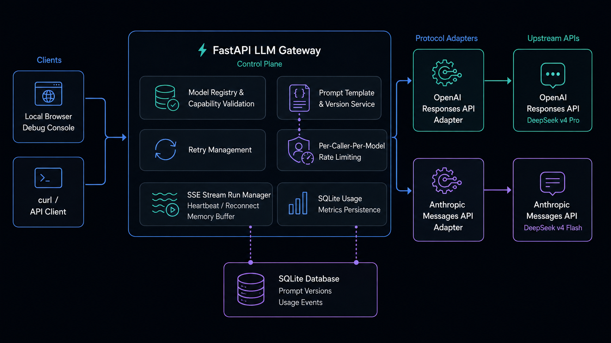

# LLM Gateway

基于 **uv + FastAPI** 构建的本地统一 LLM 网关。它以 `POST /v1/generate` 作为固定对外契约，内部通过 Adapter 层隔离不同上游协议：

| 网关模型别名 | 上游协议 | SDK Adapter |
| --- | --- | --- |
| `deepseek-v4-pro` | OpenAI Responses API | `OpenAIAdapter` |
| `deepseek-v4-flash` | Anthropic Messages API | `AnthropicAdapter` |

网关已提供多轮消息、SSE、JSON / JSON Schema 校验、Jinja2 提示词版本、调用指标、重试、按模型限流，以及本地管理与调试页面。



## 快速启动

### 前置条件

- Python `>= 3.11`
- 已安装 [uv](https://docs.astral.sh/uv/)
- 可用的 DeepSeek API Key

### 1. 安装依赖并配置环境变量

```bash
cd llm-gateway
cp .env.example .env
uv sync --all-groups
```

编辑 `.env`，至少配置：

```dotenv
DEEPSEEK_API_KEY=你的_DeepSeek_API_Key
```

默认上游地址为：

- Responses：`https://api.deepseek.com`
- Anthropic Messages：`https://api.deepseek.com/anthropic`

如需覆盖，可设置 `DEEPSEEK_BASE_URL` 和 `DEEPSEEK_ANTHROPIC_BASE_URL`。不要提交包含真实 Key 的 `.env` 文件。

### 2. 启动服务

```bash
uv run --env-file .env uvicorn app.main:app --reload
```

服务默认监听 `http://127.0.0.1:8000`。本地有图形界面时会自动打开控制台首页；可通过下面配置关闭：

```dotenv
GATEWAY_UI_AUTO_OPEN=false
```

首次进入控制台时，页面只显示环境变量是否已配置；点击“从本地环境读取”后才会将当前进程中的 Key 明文填入只读框。Key 不会被写入 `.env`、SQLite 或浏览器存储。

### 3. 健康检查

```bash
curl http://127.0.0.1:8000/healthz
```

预期响应：

```json
{"status":"ok"}
```

## 调用指南

### 单轮、非流式调用

```bash
curl http://127.0.0.1:8000/v1/generate \
  -H 'Content-Type: application/json' \
  -d '{
    "model": "deepseek-v4-pro",
    "system": "请使用简洁中文回答。",
    "user": "用一句话解释 Adapter 模式。"
  }'
```

成功结果统一为 `ModelResult`。模型文本位于 `output[*].content[*].text`，`metrics` 包含请求 ID、耗时、Token 与重试次数。

### 多轮对话

`messages` 是已有历史，`user` 是本轮最新输入；两者同时提供时，网关会把 `user` 追加在 `messages` 末尾。

```bash
curl http://127.0.0.1:8000/v1/generate \
  -H 'Content-Type: application/json' \
  -d '{
    "model": "deepseek-v4-flash",
    "messages": [
      {"role": "user", "content": "我叫小王。"},
      {"role": "assistant", "content": "你好，小王。"}
    ],
    "user": "我叫什么名字？"
  }'
```

`developer` 与 `system` 角色会在 Anthropic 协议中合并为上游 `system` 指令；`user`、`assistant` 保持对话消息语义。

### SSE 流式调用

```bash
curl -N http://127.0.0.1:8000/v1/generate \
  -H 'Content-Type: application/json' \
  -d '{
    "model": "deepseek-v4-flash",
    "user": "写一句关于春天的话。",
    "stream": true
  }'
```

默认 SSE 事件为自定义统一契约，不发送 `[DONE]`：

| 事件 | 含义 |
| --- | --- |
| `response.created` | 流已创建，携带网关 `request_id` |
| `response.output_text.delta` | 文本增量 |
| `response.completed` | 成功终态，`data.gateway_metrics` 中附带指标 |
| `response.failed` | 失败终态，附带统一错误对象与指标 |
| `: ping` | 心跳注释帧，不属于模型文本 |

如果浏览器或客户端仅断开订阅，后台 Run 会在 `STREAM_DISCONNECT_GRACE_SECONDS` 宽限期内继续运行。可使用响应头 `X-Request-ID` 重新订阅当前进程中的缓存事件：

```bash
curl -N 'http://127.0.0.1:8000/v1/streams/req_xxx/events?after_event_id=12'
```

也可传递 `Last-Event-ID: 12`。此能力只重放内存中的已生成事件，不会再次请求模型；服务重启、`--reload` 或多 Worker 部署后，缓存会丢失。

### 结构化输出

`response_format` 支持：

- `text`：默认文本输出；
- `json_object`：要求返回一个合法 JSON 对象；
- `json_schema`：要求返回满足 JSON Schema 的 JSON。

```bash
curl http://127.0.0.1:8000/v1/generate \
  -H 'Content-Type: application/json' \
  -d '{
    "model": "deepseek-v4-pro",
    "user": "提取：Ada，36岁。",
    "response_format": {
      "type": "json_schema",
      "name": "person",
      "json_schema": {
        "type": "object",
        "properties": {
          "name": {"type": "string"},
          "age": {"type": "integer"}
        },
        "required": ["name", "age"],
        "additionalProperties": false
      }
    }
  }'
```

当前 DeepSeek 注册模型采用 `prompt_only` 策略：网关会注入 JSON 约束提示词，并在本地执行 JSON / JSON Schema 校验。流式场景先发送增量，在终态前校验完整内容；校验失败会发送 `response.failed`。

### 提示词模板与版本

Prompt 使用 Jinja2 `SandboxedEnvironment` 和 `StrictUndefined` 渲染，版本存储于 SQLite。

```bash
curl -X POST http://127.0.0.1:8000/v1/prompts \
  -H 'Content-Type: application/json' \
  -d '{
    "id": "support-agent",
    "template": "你是一名 {{ role }}。",
    "role": "system",
    "activate": true
  }'
```

在模型调用中引用 active 版本：

```json
{
  "model": "deepseek-v4-flash",
  "user": "退款流程是什么？",
  "prompt": {
    "id": "support-agent",
    "variables": {"role": "客服助手"},
    "position": "system"
  }
}
```

可使用 `POST /v1/prompts/{id}/activate` 切换 active version，使用 `POST /v1/prompts/{id}/render` 预览渲染结果。模板正文和变量不会写入 usage 记录。

### 调用指标查询

```bash
curl 'http://127.0.0.1:8000/admin/usage?model=deepseek-v4-pro&status=completed&limit=50'
```

`usage_events` 保存请求 ID、模型、终态、输入/输出/总 Token、延迟、TTFT、重试次数、错误码与实际 Prompt 版本；不保存用户输入、模型输出、模板变量或 Key。

> `/admin/usage` 当前没有调用方鉴权，仅适合本地开发环境。

## 项目架构与模块职责

请求链路如下：

```text
本地控制台 / curl
        │
        ▼
POST /v1/generate（FastAPI）
        │
        ├─ PromptService：模板渲染与注入
        ├─ ModelRegistry：模型路由与能力校验
        ├─ RateLimiter：按调用方 + 模型限流
        ├─ RetryService：非流式退避重试
        └─ Adapter：协议转换与 SDK 调用
                ├─ OpenAIAdapter    → DeepSeek Responses API
                └─ AnthropicAdapter → DeepSeek Anthropic Messages API
        │
        ├─ Streaming / StreamRunManager：SSE、心跳、超时、重订阅
        └─ UsageRepository：SQLite 指标持久化
```

| 目录或模块 | 职责 |
| --- | --- |
| `app/main.py` | 应用生命周期、两模型注册、路由、请求总编排、统一错误响应。 |
| `app/data/` | Pydantic / dataclass 数据契约：请求、结果、消息、能力、Prompt、流事件、指标与 Usage。 |
| `app/adapters/base/` | `ModelAdapter` 抽象接口；统一 Key、超时、SDK 异常转换。 |
| `app/adapters/openai_adapter.py` | 将统一请求转换为 OpenAI Responses SDK 调用。 |
| `app/adapters/anthropic_adapter.py` | 将统一请求转换为 Anthropic Messages SDK 调用，并归一化事件与结果。 |
| `app/adapters/registry.py` | 维护 `model → adapter + ModelCapability` 映射，并拒绝不被模型支持的参数。 |
| `app/services/streaming.py` | SSE 终态唯一性、首 Token / 空闲超时、心跳、首 Token 前重试、流式 JSON 校验与指标。 |
| `app/services/stream_runs.py` | 后台流、订阅者游标、内存事件缓存、客户端断开宽限期和显式取消。 |
| `app/services/prompts.py` | SQLite Prompt 版本管理、active version、Jinja2 沙箱渲染与请求注入。 |
| `app/services/structured_output.py` | JSON / JSON Schema 指令构造与本地校验。 |
| `app/services/retry.py` | 非流式上游临时错误的指数退避重试，最多 3 次。 |
| `app/services/rate_limit.py` | 单进程令牌桶，按 `(caller, model)` 分桶并返回 `429` / `Retry-After`。 |
| `app/services/usage.py` | SQLite `usage_events` 的终态写入和条件查询。 |
| `app/static/` | 本地管理页面：Key 状态、聊天调试、Prompt 管理、Usage 监控。 |
| `tests/` | Adapter、SSE、Prompt、Usage、断线重订阅和 UI 回归测试。 |

## 关键配置

| 环境变量 | 默认值 | 用途 |
| --- | --- | --- |
| `DEEPSEEK_API_KEY` | 无 | 当前两个默认注册模型的上游鉴权 Key。 |
| `GATEWAY_DATABASE_PATH` | `./llm_gateway.db` | Prompt 与 Usage SQLite 数据库路径。 |
| `STREAM_FIRST_TOKEN_TIMEOUT_SECONDS` | `30` | 等待第一个文本增量的最长时间。 |
| `STREAM_IDLE_TIMEOUT_SECONDS` | `60` | 已开始输出后的最长无事件时间。 |
| `STREAM_MAX_RETRIES` | `3` | 首个文本前允许的流式重试次数。 |
| `STREAM_DISCONNECT_GRACE_SECONDS` | `60` | 无订阅者时后台流继续运行的宽限时间。 |
| `STREAM_RUN_RETENTION_SECONDS` | `600` | 已结束流在内存中的重放保留时间。 |
| `MODEL_RATE_LIMIT_REQUESTS_PER_MINUTE` | `60` | 默认单模型每调用方 RPM。 |
| `MODEL_RATE_LIMITS_PER_MINUTE` | 空 | 模型专属 RPM，例如 `deepseek-v4-pro:30,deepseek-v4-flash:60`。 |
| `GATEWAY_UI_AUTO_OPEN` | `true` | 是否自动打开本地控制台。 |
| `GATEWAY_UI_TYPEWRITER_INTERVAL_MS` | `35` | 控制台打字机的每批间隔。 |

完整示例请查看 [`.env.example`](.env.example)。

## 开发与验证

```bash
uv run pytest -q
uv run python -m compileall -q app
```

## 当前边界

- 对外协议是项目自定义的 `/v1/generate` 与统一 `response.*` SSE 事件，并非完整 OpenAI Compatible API。
- 模型注册在启动代码中固定为两个 DeepSeek 模型；尚未实现 YAML 动态路由、多供应商 fallback、加权路由或熔断器。
- 限流与流重订阅缓存均为单进程内存实现；多实例部署需要 Redis 等共享状态。
- 当前未实现网关调用方鉴权；部署到非本地环境前，应先保护 `/v1/*` 与 `/admin/*`。
- `ModelCapability.tool_calling` 仅是能力字段，尚未实现完整工具调用协议。
