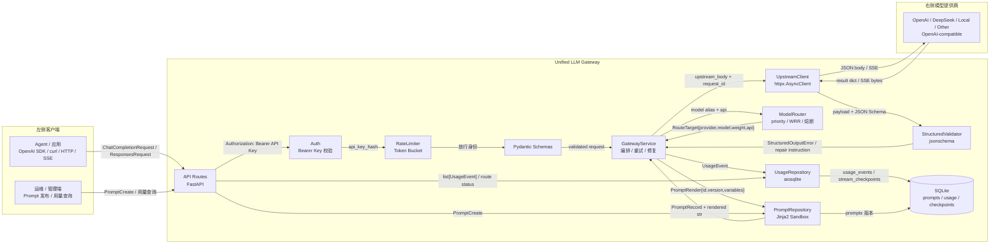

# LLM Gateway 组件级架构图

> 对应代码：`course_code/week01/1-7/llm-gateway`  
> 阅读顺序：左侧客户端 → 中间 FastAPI 网关组件 → 右侧模型提供商。  
> 图中箭头上的文字是模块之间真实传递的数据对象。

## 关键数据对象

| 数据对象 | 所在模块 | 核心字段 / 含义 |
|---|---|---|
| `ChatCompletionRequest` | `app/schemas.py` | `model`, `messages`, `stream`, `temperature`, `top_p`, `max_tokens`, `response_format`, `gateway_prompt` |
| `ResponsesRequest` | `app/schemas.py` | `model`, `input`, `stream`, `temperature`, `top_p`, `max_output_tokens`, `text`, `gateway_prompt` |
| `PromptReference` | `app/schemas.py` | `id`, `version`, `variables`, `position`（prepend/append） |
| `PromptCreate` | `app/schemas.py` | `id`, `name`, `content`, `description`, `role`, `activate` |
| `PromptRecord` | `app/schemas.py` | `id`, `version`, `name`, `description`, `role`, `content`, `is_active`, `created_at` |
| `RouteTarget` | `app/config.py` | `provider`, `model`, `weight`, `api`（chat/responses/both） |
| `CircuitState` | `app/services/router.py` | `failures`, `opened_at` |
| `OpenStream` | `app/services/upstream.py` | `response: httpx.Response`, `provider_name` |
| `StructuredOutputError` | `app/core/errors.py` | `message`, `status_code=422`, `code=invalid_model_output`, `details` |
| `UsageEvent` | `app/services/usage.py` | `request_id`, `api_key_hash`, `endpoint`, `requested_model`, `provider`, `upstream_model`, `stream`, `status`, `status_code`, `input_tokens`, `output_tokens`, `cached_tokens`, `cost_usd`, `latency_ms`, `first_token_ms`, `retries`, `fallbacks`, `error_type`, `error_message`, `prompt_id`, `prompt_version` |

## 四条核心生命周期

1. **非流式请求**：`Client → API Routes → Auth → RateLimiter → Pydantic → GatewayService → ModelRouter → UpstreamClient → Providers`，再沿响应路径返回。
2. **流式请求**：`UpstreamClient` 打开 SSE，`GatewayService` 逐块转发；若首块前失败可安全重试/切换，已发出内容后只发送错误事件并结束。
3. **结构化修复循环**：`StructuredValidator` 校验失败后，把 `StructuredOutputError` 和 `repair instruction` 反馈给 `GatewayService`，重新构造 `messages/input` 后再次调用上游，直到成功或达到 `structured_output_retries`。
4. **用量与治理**：每次请求结束时写 `UsageEvent` 到 SQLite；Prompt 版本和可选 Stream Checkpoint 也写入同一 SQLite。
