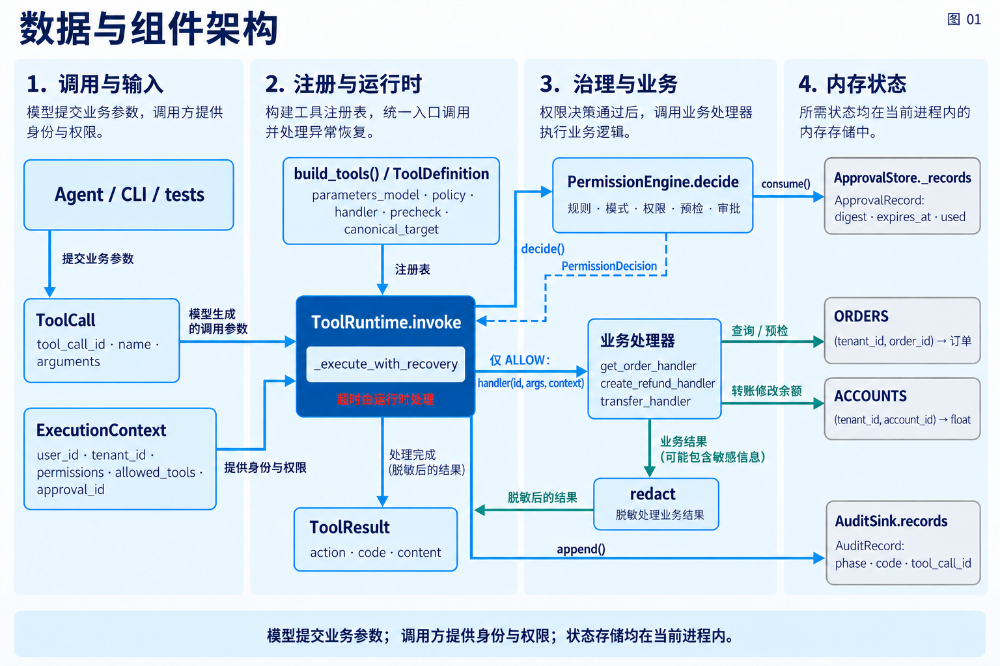
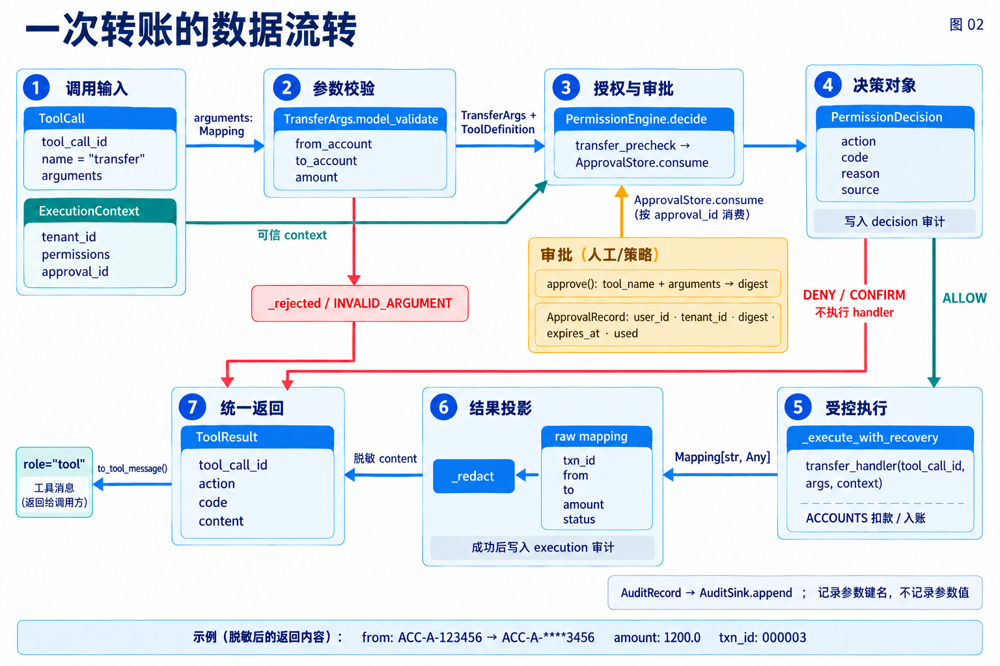
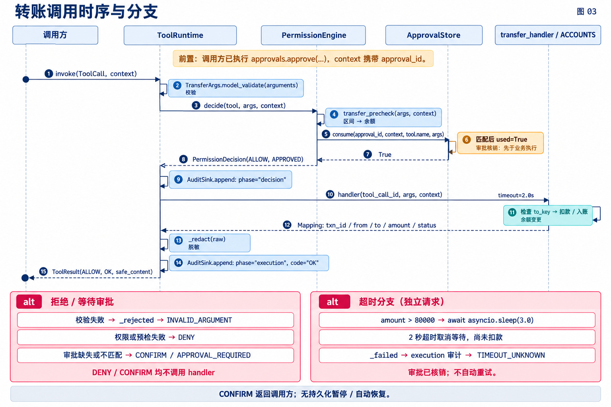

# Tool Governance：Agent 工具治理链路

本目录把模型提出的工具调用转换为可校验、可授权、可追踪的执行。核心执行入口是 [`ToolRuntime.invoke()`](tool_governance.py)，离线示例、测试和真实模型闭环都经过它。

本文依据当前 [`tool_governance.py`](tool_governance.py) 与 [`test_tool_governance.py`](test_tool_governance.py) 编写。图展示关键关系，表格保留完整字段与分支语义；开源项目资料用于解释设计原则，不代表本项目已集成对应框架。

## 1. 文件与代码层级

```text
tools/
├── __init__.py                         # 包标识，当前为空
├── tool_governance.py                  # 数据契约、治理框架、业务工具与运行入口
├── test_tool_governance.py             # 5 个转账治理链路测试
├── README.md
└── docs/
    └── images/
        ├── 01-component-architecture.jpg
        ├── 02-data-flow.jpg
        └── 03-transfer-sequence.jpg
```

这是**同一 Python 文件内的职责分层**，不是已经拆分为多个服务或子模块的部署架构。

| 层级 | 实际符号 | 职责及分层原因 |
| --- | --- | --- |
| 参数模型 | `StrictArgs`、`GetOrderArgs`、`CreateRefundArgs`、`RunShellArgs`、`TransferArgs` | 将不可信字典转换为受约束的业务参数，避免各处理器重复解析输入。 |
| 调用与策略契约 | `ToolCall`、`ExecutionContext`、`ToolPolicy`、`ToolDefinition`、`PermissionRule` | 分开描述模型候选参数、调用方身份和服务端执行配置。 |
| 决策与结果契约 | `PermissionDecision`、`ToolResult`、`AuditRecord`、相关枚举 | 用结构化动作、错误码和阶段替代依赖自然语言判断是否执行。 |
| 工具注册 | `build_tools()`、`ToolDefinition.to_model_tool()` | 用同一份注册元数据衔接模型发现与受控执行；只向模型投影公开 Schema。 |
| 权限决策 | `PermissionEngine.decide()`、`_rule_matches()` | 按固定优先级处理规则、模式、白名单、权限、业务条件和审批。 |
| 审批存储 | `ApprovalStore`、`ApprovalRecord`、`_stable_value()`、`_approval_digest()` | 把确认绑定到具体主体与具体动作，并检查有效期与一次性使用状态。 |
| 执行运行时 | `ToolRuntime.invoke()`、`_execute_with_recovery()`、`_rejected()`、`_failed()` | 编排校验、决策、限时执行、异常归一化及审计，供不同入口复用。 |
| 业务处理 | 查询、退款、转账预检和 handler、模拟 Shell | 表达领域条件和副作用，通过注册表接入运行时。 |
| 状态、脱敏与审计 | `ORDERS`、`ACCOUNTS`、`SIDE_EFFECTS`、`_redact()`、`AuditSink` | 将业务状态与返回视图分开；输出脱敏不改变账户存储。 |
| 装配与交互 | `base_context()`、`build_runtime()`、`run_offline_demo()`、`run_deepseek_agent()`、`parse_args()` | 组合依赖、组织 CLI/模型对话；业务执行仍交给统一运行时。 |

### 数据与组件架构图



图中连线表示调用或数据依赖。具体的先后顺序见后文时序表。

## 2. 信任边界与参数模型

| 信息 | 来自哪里 | 进入哪里 | 不能混淆的边界 |
| --- | --- | --- | --- |
| 业务候选参数 | 模型、CLI 或测试构造的 `ToolCall.arguments` | 对应模型的 `model_validate()` | 即使参数格式合法，也不代表获得业务权限。 |
| 调用标识 | Provider 返回的 ID，或离线调用方指定的 ID | `ToolCall.tool_call_id` → handler、结果、审计、tool 消息 | 是关联标识，不是审批凭证；不属于 `TransferArgs`。 |
| 身份与执行权限 | 可信调用方构造的 `ExecutionContext` | `invoke()`、权限引擎、预检、handler | 本模块以调用方正确构造上下文为前提，没有实现独立的用户认证服务。 |
| 工具能力和策略 | `build_tools()` 中的服务端注册 | 模型发现与执行运行时 | 模型不能通过添加参数更改 `risk`、`permission`、重试或超时策略。 |
| 审批凭证 | 调用方先执行 `approvals.approve()`，再把 ID 放入上下文 | `ApprovalStore.consume()` | 参数中的 `approved=True` 不会被当作审批，反而会因额外字段被拒绝。 |

`StrictArgs.model_config = ConfigDict(extra="forbid", strict=True)` 被所有参数模型继承。`extra="forbid"` 拦截未声明键，`strict=True` 限制宽松类型转换；这些配置约束数据结构，不负责判断自然语言内容是否可信，也不替代授权。

| 模型 | 实际字段与约束 |
| --- | --- |
| `GetOrderArgs` | `order_id: str`，匹配 `^ord_[0-9]{4}$`。 |
| `CreateRefundArgs` | `order_id` 同上；`amount: float` 满足 `0 < amount <= 10000`；`reason` 长度为 4～200。 |
| `RunShellArgs` | `command: str`，长度为 1～200。 |
| `TransferArgs` | `from_account`、`to_account` 均匹配 `^ACC-[A-Z]-[0-9]{6}$`；`amount: float` 满足 `0 < amount <= 100000`。 |

## 3. 核心数据对象

下表中的字段名均对应源码定义。`ArgsModel` 是四种业务参数模型的联合类型。

| 对象 | 职责与完整字段 | 创建者 | 使用者 | 流转位置 |
| --- | --- | --- | --- | --- |
| `ToolCall` | 原始调用：`tool_call_id`、`name`、`arguments: Mapping[str, Any]`。 | 模型适配入口、离线示例、测试。 | `ToolRuntime.invoke()`。 | 统一执行入口；原始 ID 持续关联整个调用。 |
| `ExecutionContext` | 身份与授权快照：`trace_id`、`user_id`、`tenant_id`、`mode`、`permissions`、`allowed_tools`、`approval_id=None`。 | `base_context()` 或可信调用方；测试通过覆盖字段构造场景。 | 运行时、权限引擎、审批存储、业务函数。 | 与 `ToolCall` 并列传入，不经过业务 Schema。 |
| `ToolPolicy` | 执行策略：`effect`、`risk`、`permission`、`requires_approval`、`timeout_seconds`、`max_retries`、`idempotent`。 | `build_tools()`。 | `PermissionEngine`、`_execute_with_recovery()`、超时分类逻辑。 | 作为 `ToolDefinition.policy` 进入决策与执行。 |
| `ToolDefinition` | 工具元数据：`name`、`description`、`parameters_model`、`policy`、`handler`、`canonical_target`、`precheck=None`。 | `build_tools()`。 | 运行时注册表、模型 Schema 导出、权限引擎。 | 按 `call.name` 查找；模型只看到公开投影。 |
| `PermissionRule` | 规则：`effect`（`allow`/`deny`）、`tool_name`、`target_prefix=None`。 | `DEFAULT_RULES` 或装配调用方。 | `PermissionEngine._rule_matches()` 和 `decide()`。 | 通过工具名与规则目标前缀匹配。 |
| `TransferArgs` 等参数对象 | Pydantic 校验后的业务字段；转账为两个账号与金额。 | `tool.parameters_model.model_validate(call.arguments)`。 | 权限预检、审批摘要、handler。 | 取代原始参数字典进入业务执行链。 |
| `PermissionDecision` | 决策：`action`、`code`、`reason`、`source`；来源取值为 `rule/mode/whitelist/rbac/business/approval/risk/default`。 | `PermissionEngine.decide()`。 | `ToolRuntime.invoke()`。 | `action` 决定是否执行；动作与错误码进入决策审计，`source` 不会被自动写入 `AuditRecord`。 |
| `ApprovalRecord` | 审批记录：`approval_id`、`user_id`、`tenant_id`、`tool_name`、`digest`、`expires_at`、`used=False`。 | `ApprovalStore.approve()`。 | `ApprovalStore.consume()`。 | 保存于 `_records[approval_id]`；匹配成功后 `used=True`。 |
| handler 的原始 `Mapping` | 业务结果；转账包含 `txn_id`、`from`、`to`、`amount`、`status`。 | `transfer_handler()` 等。 | 运行时与 `_redact()`。 | 成功返回后先投影为 `dict` 并脱敏，再放入 `ToolResult.content`。 |
| `ToolResult` | 统一结果：`tool_call_id`、`tool_name`、`ok`、`action`、`code`、`content`、`retryable=False`。 | `invoke()`、`_rejected()`、`_failed()`。 | 测试、离线打印、Agent 结果回填。 | `to_tool_message()` 生成 `role="tool"` 消息；`retryable` 当前没有被主动置为真，也不驱动自动重试。 |
| `AuditRecord` | 审计事件：`trace_id`、`tool_call_id`、`tool_name`、`user_id`、`tenant_id`、`phase`、`decision`、`code`、`argument_keys`、`latency_ms=None`。 | `invoke()`、`_rejected()`、`_failed()`。 | `AuditSink.append()`、测试断言。 | 保存于 `AuditSink.records`；`phase` 为 `decision` 或 `execution`。 |

### 内存状态

| 存储 | Key / Value 或条目类型 | 读写位置 |
| --- | --- | --- |
| `ORDERS` | `(tenant_id, order_id)` → 订单字典，含 `status/refundable/customer_email`。 | 查询 handler 与退款预检读取。当前退款 handler 不修改订单状态或可退金额。 |
| `ACCOUNTS` | `(tenant_id, account_id)` → `float` 余额。 | 转账预检读取转出余额；转账 handler 修改转出、转入余额。 |
| `ApprovalStore._records` | `approval_id` → `ApprovalRecord`。 | `approve()` 签发；`consume()` 校验和核销。 |
| `AuditSink.records` | `list[AuditRecord]`。 | 运行时追加；测试读取。 |
| `SIDE_EFFECTS` | `refund_executions`、`shell_executions` → 次数。 | 退款和模拟 Shell handler 更新；`reset_side_effects()` 只重置计数，不还原账户。 |

初始账户余额为：`tenant_a` 下 `ACC-A-123456=100000.0`、`ACC-A-654321=5000.0`、`ACC-A-888888=20000.0`；`tenant_b` 下 `ACC-B-111111=50000.0`。账户格式中的字母不能替代 `(context.tenant_id, account_id)` 的租户隔离检查。

## 4. 注册与固定权限决策

`build_runtime()` 调用 `build_tools()`，把工具注册表、`ApprovalStore`、`AuditSink` 与 `PermissionEngine` 装配成运行时，并返回 `(runtime, approval_store, audit_sink)`。

| 工具名 | 参数 / handler / precheck | effect / risk / permission | 审批 / 超时 / 重试 / 幂等 |
| --- | --- | --- | --- |
| `get_order` | `GetOrderArgs` / `get_order_handler` / 无 | `READ` / `MEDIUM` / `order:read` | 否 / 1 秒 / 最多 2 次重试 / 是 |
| `create_refund` | `CreateRefundArgs` / `create_refund_handler` / `refund_precheck` | `WRITE` / `HIGH` / `refund:create` | 是 / 2 秒 / 0 / 否 |
| `run_shell` | `RunShellArgs` / `simulated_shell_handler` / 无 | `SHELL` / `MEDIUM` / `shell:run` | 否 / 1 秒 / 0 / 否 |
| `transfer` | `TransferArgs` / `transfer_handler` / `transfer_precheck` | `WRITE` / `HIGH` / `transfer:execute` | 是 / 2 秒 / 0 / 否 |

`model_tools(context)` 只按 `allowed_tools` 过滤发现列表；完整 RBAC 和其他约束在执行时重新检查。`to_model_tool()` 导出名称、描述与 JSON Schema，不导出 handler、审批存储或服务端策略。

`PermissionEngine.decide()` 的实际优先级如下；**命中提前返回的分支后，不再执行后续检查**。

| 顺序 | 条件 | 结果 |
| --- | --- | --- |
| 1 | 匹配 `deny` 规则 | `DENY / DENY_RULE`。 |
| 2 | `PLAN` 模式且 effect 不是 `READ` | `DENY / PLAN_MODE_DENIED`。 |
| 3 | 工具不在 `allowed_tools` | `DENY / TOOL_NOT_ALLOWED`。 |
| 4 | 缺少 `tool.policy.permission` | `DENY / PERMISSION_DENIED`。 |
| 5 | 业务 `precheck()` 抛出 `PolicyDenied` | `DENY`，保留业务错误码。 |
| 6 | `requires_approval` 或 `Risk.HIGH` | 审批匹配则核销并返回 `ALLOW / APPROVED`；不匹配时通常为 `CONFIRM / APPROVAL_REQUIRED`，`DONT_ASK` 为 `DENY / APPROVAL_REQUIRED`。 |
| 7 | `BYPASS_PERMISSIONS` | 返回 `ALLOW / BYPASS_ALLOWED`；不能绕过前面已经检查的硬边界和强制审批。 |
| 8 | 匹配普通 `allow` 规则 | `ALLOW / ALLOW_RULE`。 |
| 9 | Shell 命中危险命令特征 | 通常为 `CONFIRM / DANGEROUS_OPERATION`；`DONT_ASK` 为 `DENY`。 |
| 10 | 未命中前述返回条件 | `ALLOW / DEFAULT_ALLOWED`。 |

这张表描述现有控制流，不把 Shell 正则检查当作沙箱。普通 allow 和 bypass 位于 Shell 正则兜底之前；`simulated_shell_handler()` 本身只返回模拟结果，不启动系统命令。

## 5. 一次转账的数据流



以下以 `tenant_a` 从 `ACC-A-123456` 向 `ACC-A-654321` 转账 `1200.0` 为例。

| 步骤 | 组件 / 方法 | 输入对象 | 输出 / 状态变化 |
| --- | --- | --- | --- |
| 1 | 调用方构造请求 | `ToolCall("call_tr_000003", "transfer", arguments)`；并列的 `ExecutionContext`。 | 参数字典仅含两个账号和金额；上下文另含租户、`transfer:execute`、白名单和审批 ID。 |
| 2 | `ToolRuntime.invoke()` 查注册表 | `call.name`。 | 取得 `ToolDefinition`；不存在时调用 `_rejected()`。 |
| 3 | `TransferArgs.model_validate()` | `call.arguments: Mapping`。 | 生成 `TransferArgs`；非法参数转为字段路径与错误消息，不进入业务预检。 |
| 4 | `PermissionEngine.decide()` | `ToolDefinition`、`TransferArgs`、`ExecutionContext`。 | 依固定优先级检查规则、模式、白名单、业务权限。 |
| 5 | `transfer_precheck()` | `TransferArgs + context`。 | 先拦截 `50000 < amount <= 80000`；再读取 `(tenant_id, from_account)` 的余额。不存在的转出账户按余额 `0.0` 处理，不修改余额。 |
| 6 | `ApprovalStore.consume()` | `context.approval_id`、身份、工具名、校验后的参数。 | 检查审批存在、未使用、未过期且主体、租户、工具、摘要都匹配；成功后立即设置 `used=True`。 |
| 7 | 权限引擎返回 | `PermissionDecision(ALLOW, APPROVED, reason, "approval")`。 | 运行时写入 `phase="decision"` 审计；只有 `ALLOW` 进入执行。 |
| 8 | `_execute_with_recovery()` | 工具定义、原始调用 ID、`TransferArgs`、上下文。 | 应用 2 秒单次超时；转账不重试；调用 `handler(tool_call_id, args, context)`。 |
| 9 | `transfer_handler()` | 调用 ID、业务参数、可信租户。 | 大于 80000 时先延迟 3 秒；随后检查转入账户存在，再扣款、入账。当前成功示例余额变为 `98800.0` 和 `6200.0`。 |
| 10 | handler 返回 | 原始结果 `Mapping`。 | `txn_id="000003"`；`from/to` 此时仍是完整账号；金额 `1200.0`，`status="accepted"`。 |
| 11 | `_redact(dict(raw))` | 原始结果映射。 | 返回视图中的账号变为 `ACC-A-****3456`、`ACC-A-****4321`；内存账户键不变。 |
| 12 | 运行时记录执行事件 | 调用上下文、参数键名、耗时。 | 追加 `phase="execution", decision="executed", code="OK"` 的 `AuditRecord`。 |
| 13 | 构造 `ToolResult` | 原调用 ID、工具名、脱敏结果。 | `ok=True, action=ALLOW, code="OK", retryable=False`。 |
| 14 | Agent 可选回填 | `result.to_tool_message()`。 | 生成带相同 `tool_call_id` 的 `role="tool"` 消息；离线示例和测试可直接使用结果，无须调用模型。 |

业务结果与治理结果分开表达：`content.status="accepted"` 是 handler 的业务状态；`ToolResult.code="OK"` 是运行时执行成功；此前授权审计的 `code="APPROVED"` 则表示审批匹配。

## 6. 调用时序与失败分支



图中的 `args` 表示已校验的业务参数对象；源码 handler 的形参名为 `raw_arguments`，运行时以 `arguments` 变量按位置传入。图内 `PermissionDecision(...)`、`ToolResult(...)` 等标签仅突出关键字段，不是可直接复制执行的构造代码；完整字段见第 3 节。

### 6.1 审批前后的两次调用

`CONFIRM` 是普通返回结果。运行时没有停在一个等待人工输入的栈帧上；调用方取得审批后，需要携带 `approval_id` 重新调用 `invoke()`。

下面的命令在 `tools/` 目录执行，仅使用内存数据，业务调用全部走运行时：

```bash
python - <<'PY'
import asyncio
from dataclasses import replace
import tool_governance as demo

async def main():
    runtime, approvals, audit = demo.build_runtime()
    ctx = demo.base_context(
        permissions=frozenset({"transfer:execute"}),
        allowed_tools=frozenset({"transfer"}),
    )
    arguments = {
        "from_account": "ACC-A-123456",
        "to_account": "ACC-A-654321",
        "amount": 1200.0,
    }
    pending = await runtime.invoke(
        demo.ToolCall("call_tr_000001", "transfer", arguments), ctx
    )
    print(pending.action, pending.code)

    approvals.approve("approval_transfer", ctx, "transfer", arguments)
    approved_ctx = replace(ctx, approval_id="approval_transfer")
    result = await runtime.invoke(
        demo.ToolCall("call_tr_000003", "transfer", arguments), approved_ctx
    )
    print(result.action, result.code, result.content)
    print([(record.phase, record.code) for record in audit.records])

asyncio.run(main())
PY
```

预期关键输出：

```text
confirm APPROVAL_REQUIRED
allow OK {'txn_id': '000003', 'from': 'ACC-A-****3456', 'to': 'ACC-A-****4321', 'amount': 1200.0, 'status': 'accepted'}
[('decision', 'APPROVAL_REQUIRED'), ('decision', 'APPROVED'), ('execution', 'OK')]
```

审批不会绑定调用 ID，因此同一组已批准参数可以在新的调用 ID 下执行；审批绑定的是主体、租户、工具和参数。成功核销后，原凭证再次使用会重新得到 `APPROVAL_REQUIRED`。`txn_id` 只是调用 ID 后六位，不保证跨调用全局唯一，也不实现业务幂等。

### 6.2 各分支具体在哪里结束

| 场景 / 触发点 | 动作与错误码 | 审计 | handler / 余额 / 审批状态 |
| --- | --- | --- | --- |
| 未注册工具 / `invoke()` 查表 | `DENY / TOOL_NOT_FOUND` | `_rejected()` 写 `decision`。 | handler 不执行。 |
| 额外字段、错误账号、零金额、超过 Schema 上限 / `model_validate()` | `DENY / INVALID_ARGUMENT` | `_rejected()` 写 `decision`。 | 不进入预检和审批，余额不变。 |
| deny 规则、plan 模式、白名单或 RBAC 不满足 / `decide()` | `DENY`，分别为 `DENY_RULE/PLAN_MODE_DENIED/TOOL_NOT_ALLOWED/PERMISSION_DENIED` | `invoke()` 写 `decision`。 | handler 不执行，审批未核销。 |
| `50000 < amount <= 80000` / `transfer_precheck()` | `DENY / EXCEED_LIMIT` | 仅 `decision`。 | 先于余额检查返回，余额不变，审批未核销。 |
| 转出余额小于金额或转出账户不存在 / `transfer_precheck()` | `DENY / INSUFFICIENT_BALANCE` | 仅 `decision`。 | handler 不执行，审批未核销。 |
| 审批缺失、过期、已使用或参数不匹配 / `consume()` 返回假 | 通常 `CONFIRM / APPROVAL_REQUIRED`；`DONT_ASK` 为 `DENY` | 仅 `decision`。 | handler 不执行；参数不匹配不会消耗原本有效的审批。 |
| 审批通过、正常转账 | `ALLOW / OK` | 先 `decision:APPROVED`，再 `execution:OK`。 | 先核销审批，再更新余额；结果账号脱敏。 |
| 转入账户不存在 / handler | `DENY / ACCOUNT_NOT_FOUND` | 已有 `decision:APPROVED`，再写 `execution:ACCOUNT_NOT_FOUND`。 | 检查发生在扣款前，余额不变；审批已经核销。 |
| 金额大于 80000、余额与审批均满足 / handler 延迟 | `DENY / TIMEOUT_UNKNOWN` | `decision:APPROVED` 后追加失败的 `execution`。 | 2 秒超时先于 3 秒延迟结束，当前路径没有扣款；审批已核销且不自动重试。 |
| 其他处理器异常 | `DENY / TOOL_ERROR` | `_failed()` 写 `execution`。 | 结果取决于异常发生的位置；本框架不执行副作用回滚。 |

`_failed()` 的 `ToolResult.action` 为 `DENY`，不表示该调用此前没有被授权，也不能据此推断外部写入一定未发生。异常结果需要结合 `code` 和执行审计理解。

## 7. 为什么这样设计

### 严格参数模型与可信上下文分离

让模型只描述“希望做什么”，让调用方决定“谁有权做”。账号和金额属于 `TransferArgs`，用户、租户、权限、模式及审批 ID 属于 `ExecutionContext`。运行时把调用 ID 单独作为第一个参数传入 handler，避免为此向业务 Schema 增加可注入字段。

这与 [LangChain Tools 的参数 Schema 与运行时上下文分离](https://docs.langchain.com/oss/python/langchain/tools) 原则一致。这里使用自定义 `ToolRuntime`，没有导入 LangChain 的同名类型。字段拒绝与类型约束分别参考 [Pydantic extra 配置](https://docs.pydantic.dev/latest/api/config/#pydantic.config.ConfigDict.extra) 和 [Strict Mode](https://docs.pydantic.dev/latest/concepts/strict_mode/)。

### 审批绑定动作，而不是一个可复用的“已批准”布尔值

`approve()` 保存用户、租户、工具、摘要、过期时间与使用状态。摘要计算过程为：

```text
工具名 + ":" + JSON(_stable_value(arguments), ensure_ascii=False, separators=(",", ":"))
                              ↓ UTF-8 编码与 SHA-256
                            digest
```

`_stable_value()` 递归排序映射键，Pydantic 对象先执行 `model_dump(mode="json")`。字段顺序变化不会改变摘要；金额或账户变化需要新的审批。签发方应使用与执行校验后相同表示的参数：这里没有把任意原始整数、字符串和浮点金额都归一成相同摘要。

摘要不是签名，信任来自服务端审批记录。`consume()` 匹配后立即设置 `used=True`，因此一个凭证只能放行一次调用；随后执行失败也不会自动恢复审批。

[LangGraph Interrupts](https://docs.langchain.com/oss/python/langgraph/interrupts) 说明了在关键副作用前等待审批、以及恢复时考虑幂等性的重要性。本实现通过返回 `CONFIRM` 并重新提交调用实现交互，没有 LangGraph 的 checkpoint 或持久化恢复。

### `canonical_target` 与审批摘要有不同用途

| 比较 | `canonical_target(arguments)` | `_approval_digest(tool_name, arguments)` |
| --- | --- | --- |
| 返回值 | 可读目标字符串。 | SHA-256 十六进制摘要。 |
| 谁调用 | `_rule_matches()`，在规则指定 `target_prefix` 时使用。 | `ApprovalStore.approve()` 和 `consume()`。 |
| 用途 | 与 `target_prefix` 做 `startswith()` 匹配，控制规则适用目标。 | 校验审批是否绑定当前工具与完整参数。 |
| 转账形式 | `from_account:to_account:amount`。 | 工具名及规范化参数生成的摘要。 |
| 当前不承担的职责 | 不参与审批摘要，不生成写锁或事务锁。 | 不提供身份认证、消息签名或业务幂等去重。 |

### 非幂等转账不自动重试

运行时只捕获 `TransientToolError` 进入重试分支，且只有 `READ` 或显式 `idempotent=True` 的工具具备重试资格。重试次数来自 `max_retries`，等待为 `min(0.05 * 2**attempt, 0.2)` 秒；每次尝试分别应用 `timeout_seconds`。

转账是 `WRITE`、`idempotent=False`、`max_retries=0`。审批与幂等不是同一机制：审批限制动作是否获准；业务幂等需要保证重复请求不重复扣款，本实现没有交易去重存储。异常筛选、次数和等待策略的分离与 [Tenacity](https://tenacity.readthedocs.io/en/stable/index.html) 的设计方式一致，源码没有使用该库执行重试。

### 超时、脱敏和审计保留不同语义

- 超时限制等待时间，并不提供事务回滚。非幂等写超时统一报告 `TIMEOUT_UNKNOWN`，避免把未知结果当作可以安全重试的失败；当前转账故障注入恰好在扣款前，所以测试可进一步断言余额没有变化。取消行为可参阅 [Python asyncio.timeout](https://docs.python.org/3/library/asyncio-task.html#asyncio.timeout)。
- `_redact()` 在成功路径递归处理映射、列表、元组和字符串；敏感键匹配 `token/secret/password/authorization`，邮箱与账号按模式替换。这里没有覆盖所有个人信息，也没有统一脱敏异常字符串或字典键中的账号。
- 审计只保留 `argument_keys` 而不保存原始业务参数值；用户、租户、工具和调用 ID 保留用于追踪。`decision` 阶段记录授权结果，`execution` 阶段记录成功或失败，避免把“已批准”误当作“已成功执行”。

## 8. 当前实现与扩展边界

| 当前已有 | 尚未实现的扩展方向 |
| --- | --- |
| 模块内注册表、严格参数模型、固定权限优先级。 | 动态插件注册、独立认证接入、权限策略持久化。 |
| 内存审批及一次性核销。 | 持久化审批、跨进程原子核销、人工审批 UI、checkpoint 恢复。 |
| 以租户和业务标识共同查询内存数据。 | 数据库事务、并发余额锁、持久账本、交易幂等去重。 |
| 两次余额更新之间没有 `await` 的内存转账。 | 通用回滚或跨服务一致性保证；当前两次更新不等于数据库事务。 |
| 成功结果的规则脱敏、内存审计列表。 | 全返回路径脱敏、持久审计、完整敏感信息识别及检索平台。 |
| 最多八轮的串行 Agent 工具执行闭环。 | 持久会话、并行工具调度、长任务恢复；这些能力不能从参考框架文档直接推定。 |
| 查询、退款受理、转账和模拟 Shell。 | 真实支付接口和真实 Shell 执行；退款 handler 目前仅计数并返回受理数据。 |

## 9. 安装、运行与测试

### 环境与依赖

实际代码使用 `StrEnum` 和 `asyncio.timeout`，运行解释器需要 **Python 3.11+**；仓库根 `pyproject.toml` 目前声明的 `>=3.9` 不能准确表达本模块的这一要求，且依赖列表为空。本文只说明现状，不修改配置。

在所选 Python 环境中安装离线所需依赖：

```bash
python -m pip install "pydantic>=2,<3" pytest
```

### 离线示例

从仓库根目录进入本目录：

```bash
cd tools
python tool_governance.py
```

依次打印查询成功、退款等待审批、审批后退款成功、额外参数拒绝、危险 Shell 硬拒绝、plan 模式拒绝，以及汇总。汇总预期为：

```json
{"side_effects": {"refund_executions": 1, "shell_executions": 0}, "audit_records": 8}
```

这个离线入口默认不调用转账。`base_context()` 的默认权限和白名单不含 `transfer`，需要像第 6 节示例一样显式覆盖。

### 五个转账链路测试

测试中使用平级导入 `import tool_governance as demo`。推荐在 `tools/` 目录使用：

```bash
python -m pytest ./test_tool_governance.py -v -k "transfer"
```

也可从仓库根目录显式提供模块路径：

```bash
PYTHONPATH=tools python -m pytest tools/test_tool_governance.py -v -k "transfer"
```

预期是 **5 passed**，总耗时约 2 秒，主要来自真实的 2 秒超时用例。详细测试名及覆盖点：

| 测试函数 | 核验边界 |
| --- | --- |
| `test_transfer_rejects_injected_arguments_and_invalid_amount` | 额外身份字段、账号格式、零金额、超过 Schema 上限及余额不变。 |
| `test_transfer_precheck_blocks_over_limit_and_insufficient_balance` | 禁止区间、余额不足、审批不能覆盖业务拒绝。 |
| `test_transfer_is_denied_without_permission_or_whitelist_and_in_plan_mode` | RBAC、工具白名单和 plan 限制。 |
| `test_transfer_requires_approval_bound_to_arguments_and_masks_accounts` | 等待审批、金额篡改、成功余额、调用 ID 后六位、账号脱敏、审计事件及审批重放拒绝。 |
| `test_transfer_timeout_is_reported_as_unknown_and_leaves_balances_untouched` | 超时早于延迟结束、`TIMEOUT_UNKNOWN`、双方余额不变及执行审计。 |

这些测试均通过 `runtime.invoke()` 执行业务工具。`async_test` 为每个用例创建事件循环；`isolated_accounts` 快照并原地恢复账户字典，同时重置退款和 Shell 执行计数。当前五个测试未穷举审批过期、跨租户访问和收款账户缺失等全部分支。

### 可选真实模型入口

```bash
python -m pip install openai
# 在本地环境设置 DEEPSEEK_API_KEY，不要把真实密钥写入源码或 README。
python tool_governance.py --agent --input "请查询订单 ord_1001 的状态和可退金额"
```

`DEEPSEEK_BASE_URL` 与 `DEEPSEEK_MODEL` 可覆盖源码中的服务地址与模型名。该入口当前把白名单收窄为 `get_order`，不会自动开放转账或弹出转账审批；本文的验证不向外部模型发送请求。

### 模型闭环如何回填结果

1. `run_deepseek_agent()` 调用流式模型接口，传入 `runtime.model_tools(context)`。
2. 按流式 `delta_call.index` 聚合工具名、调用 ID 和参数 JSON 分片。
3. 先把含 `tool_calls` 的 assistant 消息加入 `messages`。
4. 将每个调用转换为 `ToolCall`，依次执行 `runtime.invoke()`；JSON 解析失败会转成含 `_invalid_json` 的字典，由 Schema 拒绝并进入审计。
5. `ToolResult.to_tool_message()` 沿用原 ID，追加对应 tool 消息，再进入下一轮。
6. 模型不再提出工具调用时结束；八轮后仍未结束则抛出循环次数上限异常。

## 10. 图像制作与一致性说明

三张图片使用内置图像生成模型分别生成，再以 JPEG 编码保存；没有用 Mermaid、SVG 或手写绘图替代图像生成。图中只列关键字段，完整契约以第 3 节及源码为准。图的生成提示词在下方附录保留，便于后续维护。

本次只新增 README 和三张图片，不修改现有 Python 源码、测试、配置或权限判定逻辑。校验包括源码文件摘要、实际测试、离线示例、README 示例、图片格式、引用路径，以及图中关键对象和箭头顺序的逐图核对。


### 10.1 本次验证记录

验证日期：2026-10-14（Asia/Shanghai）。离线验证使用 Python 3.12.2 / pytest 7.4.4。

| 检查 | 结果 |
| --- | --- |
| 五个现有转账测试 | `5 passed in 2.08s`；所有业务调用经过 `runtime.invoke()`。 |
| 第 6 节 README 转账示例 | 实际执行，确认审批前后动作、交易编号、账号脱敏和三条审计事件与示例一致。 |
| 离线 CLI | 实际执行，六个调用结果与 8 条审计汇总一致。 |
| 核心契约字段 | 从 Python AST 提取九个核心数据类的全部字段，与第 3 节逐项核对。 |
| 已有文件保护 | 对既有源码、测试、`__init__.py`、`.gitignore` 和 `pyproject.toml` 比较 SHA-256，内容不变。 |
| 真实模型服务 | 未发起请求；模型可用性与远端服务响应不属于本次离线验证结果。 |
| 图片与引用 | 3 张 RGB JPEG，均为 1536×1024；逐图检查英文标识、中文说明、审批核销顺序与原始结果→脱敏→返回的路径，并验证本地引用。 |

### 10.2 图像生成提示词

生成方式：内置图像生成工具。以下保留原始提示词与定向修正提示词；JPEG 转码只改变编码格式，没有重新绘制图内文字或箭头。

<details>
<summary>图 01：原始生成提示词</summary>

```text
Use case: infographic-diagram. Asset type: a technical README illustration. Create ONE standalone landscape technical diagram, about 2400x1600 pixels or higher, with crisp legible Simplified Chinese captions and exact English Python identifiers. Consistent visual system: white/very light blue background, dark navy typography, blue rounded rectangles for code, teal for trusted/runtime data, amber for approval, red only for denied/timeout branches, pale gray cards for in-memory stores. Large typography and spacious grid. Orthogonal arrows with clear arrowheads and no crossings through text. Flat editorial engineering diagram, not a screenshot, not hand drawn, no logos, no invented components. Chinese title at top left, diagram number small at top right. Every specified code identifier must be spelled exactly. Do not add decorative filler or unsupported databases/checkpointing/queues. Render only the supplied diagram; the detailed field tables are in the README.
Title: "数据与组件架构"  Number: "01"
This diagram describes the ACTUAL architecture of a small Python Agent tool governance module.
Arrange four organized visual columns, from caller to configuration/runtime to execution components to in-memory state.

Column 1 "调用与输入": card "Agent / CLI / tests"; beneath it two separate input cards:
"ToolCall" with "tool_call_id · name · arguments"
"ExecutionContext" with "user_id · tenant_id · permissions · allowed_tools · approval_id".
Arrow from each input to ToolRuntime.invoke. Context comes from the trusted caller, NOT from ToolCall.arguments.

Column 2 "注册与运行时": a top card "build_tools()" / "ToolDefinition" with "parameters_model · policy · handler · precheck · canonical_target". Its arrow "注册表" goes to the central large card "ToolRuntime.invoke". In that card include smaller line "_execute_with_recovery". An output card below is "ToolResult" with "action · code · content".
Column 3 "治理与业务": top card "PermissionEngine.decide" with "规则 · 模式 · 权限 · 预检 · 审批"; arrow from runtime to this card labeled "TransferArgs + context". A business card "业务处理器" lists "get_order_handler", "create_refund_handler", "transfer_handler". Runtime calls it via "_execute_with_recovery", only following "ALLOW". A bottom card "_redact" links successful business results to ToolResult.
Column 4 "内存状态": four distinct compact cards:
"ApprovalStore._records" / "ApprovalRecord: digest · expires_at · used" linked from PermissionEngine.decide with arrow label "consume()";
"ORDERS" / "(tenant_id, order_id) → 订单" linked from business handlers, label "查询 / 预检";
"ACCOUNTS" / "(tenant_id, account_id) → float" linked from business handlers, label "转账修改余额";
"AuditSink.records" / "AuditRecord: phase · code · tool_call_id" linked FROM runtime, label "append()".
Footer: "模型提交业务参数；调用方提供身份与权限；状态存储均在当前进程内。"
Constraints: runtime, not the permission engine, appends audit events. The transfer handler changes ACCOUNTS, not ORDERS. No SQL database. canonical_target is a permission-rule target, NOT the approval digest.
```

</details>

<details>
<summary>图 02：原始生成提示词</summary>

```text
Use case: infographic-diagram. Asset type: a technical README illustration. Create ONE standalone landscape technical diagram, about 2400x1600 pixels or higher, with crisp legible Simplified Chinese captions and exact English Python identifiers. Consistent visual system: white/very light blue background, dark navy typography, blue rounded rectangles for code, teal for trusted/runtime data, amber for approval, red only for denied/timeout branches, pale gray cards for in-memory stores. Large typography and spacious grid. Orthogonal arrows with clear arrowheads and no crossings through text. Flat editorial engineering diagram, not a screenshot, not hand drawn, no logos, no invented components. Chinese title at top left, diagram number small at top right. Every specified code identifier must be spelled exactly. Do not add decorative filler or unsupported databases/checkpointing/queues. Render only the supplied diagram; the detailed field tables are in the README.
Title: "一次转账的数据流转" Number: "02"
Create a precise numbered data-flow diagram, wide and readable with a two-row serpentine main path and small side cards for approval and audit.
Main path of seven numbered large cards:
1 "调用输入" : "ToolCall" fields "tool_call_id / name='transfer' / arguments"; beside it separate teal "ExecutionContext" fields "tenant_id / permissions / approval_id".
2 "参数校验" : "TransferArgs.model_validate" and exact fields "from_account / to_account / amount".
3 "授权与审批" : "PermissionEngine.decide" smaller "transfer_precheck → ApprovalStore.consume".
4 "决策对象" : "PermissionDecision" fields "action / code / reason / source".
5 "受控执行" : "_execute_with_recovery" calls "transfer_handler(tool_call_id, args, context)" and small note "ACCOUNTS 扣款 / 入账".
6 "结果投影" : raw mapping fields "txn_id / from / to / amount / status" goes through "_redact".
7 "统一返回" : "ToolResult" fields "tool_call_id / action / code / content", then a short final arrow labeled "to_tool_message()" toward "role='tool'".
Show arrows between cards labeled with the ACTUAL objects: input→validation "arguments: Mapping"; validation→decide "TransferArgs + context + ToolDefinition"; decide→decision "PermissionDecision"; decision→execution "仅 ALLOW"; execution→projection "Mapping[str, Any]"; projection→return "脱敏 content".
PermissionDecision DENY or CONFIRM branches go directly to ToolResult WITHOUT calling the transfer handler.
Validation failure goes to "_rejected" then "ToolResult: INVALID_ARGUMENT".
An amber approval side card has exactly two separate lines:
"approve(): tool_name + arguments → digest"
"ApprovalRecord: user_id · tenant_id · digest · expires_at · used"
A consume arrow joins this card to authorization. Do not show canonical_target as the digest.
An audit side strip: "AuditRecord → AuditSink.append" and "决策后 phase='decision'；执行成功或失败 phase='execution'". Note "记录参数键名，不记录参数值".
Footer example in one readable line: "from: ACC-A-123456 → ACC-A-****3456    amount: 1200.0    txn_id: 000003".
Constraints: the caller injects call ID and context independently of business arguments. Audit at decision is written BEFORE handler execution. The successful raw mapping is redacted BEFORE it enters ToolResult. No claim that failure strings are universally redacted.
```

</details>

<details>
<summary>图 03：原始生成提示词</summary>

```text
Use case: infographic-diagram. Asset type: a technical README illustration. Create ONE standalone landscape technical diagram, about 2400x1600 pixels or higher, with crisp legible Simplified Chinese captions and exact English Python identifiers. Consistent visual system: white/very light blue background, dark navy typography, blue rounded rectangles for code, teal for trusted/runtime data, amber for approval, red only for denied/timeout branches, pale gray cards for in-memory stores. Large typography and spacious grid. Orthogonal arrows with clear arrowheads and no crossings through text. Flat editorial engineering diagram, not a screenshot, not hand drawn, no logos, no invented components. Chinese title at top left, diagram number small at top right. Every specified code identifier must be spelled exactly. Do not add decorative filler or unsupported databases/checkpointing/queues. Render only the supplied diagram; the detailed field tables are in the README.
Title: "转账调用时序与分支" Number: "03"
Create an accurate UML-like sequence diagram with five swimlanes, left-to-right:
"调用方" | "ToolRuntime" | "PermissionEngine" | "ApprovalStore" | "transfer_handler / ACCOUNTS".
Time runs downward. Use exact method/field labels below, short Chinese notes, large enough text. The main approved success path occupies the upper two-thirds. Two aligned branch panels at the bottom explain rejection and timeout without drawing them as actions after success.

Main approved path:
(1) Caller → runtime: "invoke(ToolCall, context)"
(2) runtime self-call: "TransferArgs.model_validate(arguments)" (note "校验")
(3) runtime → permission engine: "decide(tool, args, context)"
(4) engine self-call: "transfer_precheck(args, context)" (note "区间 → 余额")
(5) engine → approval store: "consume(approval_id, context, tool.name, args)"
(6) approval store self-action: "匹配后 used=True" highlighted amber with annotation "审批核销：先于业务执行".
(7) store returns "True"; engine returns "PermissionDecision(ALLOW, APPROVED)" to runtime.
(8) runtime self-action: "AuditSink.append: phase='decision'"
(9) runtime → handler: "handler(tool_call_id, args, context)" annotated "timeout=2.0s".
(10) handler self-action: "检查 to_key → 扣款 / 入账" highlighted teal "余额变更".
(11) handler → runtime: "Mapping: txn_id / from / to / amount / status"
(12) runtime self-actions in order: "_redact(raw)" highlighted "脱敏"; "AuditSink.append: phase='execution', code='OK'"
(13) runtime → caller: "ToolResult(ALLOW, OK, safe_content)".
Above main path in small amber callout: "前置：调用方已执行 approvals.approve(...)，context 携带 approval_id。"

Bottom-left branch panel titled "拒绝 / 等待审批":
"校验失败 → _rejected → INVALID_ARGUMENT"
"权限或预检失败 → DENY"
"审批缺失或不匹配 → CONFIRM / APPROVAL_REQUIRED"
"DENY / CONFIRM 均不调用 handler".
Bottom-right branch panel titled "超时分支（独立请求）":
"amount > 80000 → await asyncio.sleep(3.0)"
"2 秒超时取消等待，尚未扣款"
"_failed → execution 审计 → TIMEOUT_UNKNOWN"
"审批已核销；不自动重试".
Footer: "CONFIRM 返回调用方；无持久化暂停 / 自动恢复。"
Constraints: branch panels are ALTERNATIVES, not sequential steps after the successful transfer. The decision audit happens after decide returns, including after consume, not before approval consumption. Do NOT invent a call from the handler to ApprovalStore.
```

</details>

<details>
<summary>图 01：箭头关系修正提示词</summary>

```text
Edit the attached architecture diagram, retaining its visual system, title, all data cards and their exact code text. Correct the CALL ARROWS to match the real code; reflow spacing if necessary, prioritize unambiguous arrows over preserving coordinates.
The actual calls are:
A. ToolRuntime.invoke → PermissionEngine.decide, label "decide(tool, args, context)". Add this currently missing arrow.
B. PermissionEngine.decide → ToolRuntime.invoke, dashed return label "PermissionDecision". ALL ALLOW/DENY/CONFIRM decisions return to runtime. Remove the existing engine→business-handler ALLOW arrow entirely.
C. ToolRuntime.invoke via _execute_with_recovery → 业务处理器, label "仅 ALLOW：handler(id, args, context)". The existing direct runtime→handler connection must clearly be gated by ALLOW and NOT be the call to decide.
D. Engine → ApprovalStore._records, label "consume()"; keep this relationship.
E. Runtime → AuditSink.records, label "append()"; keep.
F. Handler→_redact→ToolResult is successful result flow. Keep memory data relations to ORDERS and ACCOUNTS.
Remove the entire red "DENY / TIMEOUT" engine return line and its label: timeout is NOT produced by the permission engine. If a timeout note is included, put a small red note INSIDE the runtime card: "超时由运行时处理".
Do not add any other arrows. Orthogonal routes must avoid crossing cards or labels. It is acceptable to reorganize the four-column grid slightly to create a clear roundtrip between runtime and permission engine. Keep Simplified Chinese clean and English identifiers exact. This is a static component relationship diagram; do not invent source-code capabilities.
```

</details>

<details>
<summary>图 02：箭头关系修正提示词</summary>

```text
Edit the attached "一次转账的数据流转" diagram, preserving its title, white/navy/blue/teal/amber visual style, all code identifiers and field spellings. Correct the ambiguous routing of ALLOW and add the separate trusted context input. You may rearrange boxes to produce a clear readable graph.
Use seven numbered cards: top row 1→2→3→4; bottom row is reversed, with 5 on the RIGHT, 6 in the CENTER, 7 on the LEFT. This creates a simple snake 1→2→3→4↓5→6→7. Use left-pointing arrows along the bottom row.
1 input: ToolCall and a distinct teal ExecutionContext.
2 validation: TransferArgs.model_validate and its three fields.
3 authorization: PermissionEngine.decide; transfer_precheck → ApprovalStore.consume.
4 PermissionDecision with action/code/reason/source. Directly below this card write a small label "写入 decision 审计".
5 execution: _execute_with_recovery; transfer_handler(tool_call_id, args, context); ACCOUNTS 扣款/入账.
6 result: raw Mapping fields txn_id/from/to/amount/status → _redact; note "成功后写入 execution 审计".
7 ToolResult: tool_call_id/action/code/content; then small arrow to role='tool' labeled to_tool_message().
CRITICAL: exactly ONE teal ALLOW arrow connects card 4 to card 5, with no junction or arrow to card 7. Successful output MUST traverse 5 and 6 before 7.
DENY/CONFIRM use a separate RED bypass arrow from card 4 to card 7; label "不执行 handler".
Validation failure from card 2 uses a RED small callout "_rejected / INVALID_ARGUMENT", connected directly to card 7.
Add a separate TEAL input arrow from ExecutionContext in card 1 to PermissionEngine.decide in card 3, labeled "可信 context"; context must not be shown as validated by TransferArgs.model_validate.
Keep the amber approval side card: "approve(): tool_name + arguments → digest" and "ApprovalRecord: user_id · tenant_id · digest · expires_at · used", with an approval link to card 3.
Replace the wide connected audit bus with a compact NON-CONNECTING legend: "AuditRecord → AuditSink.append；记录参数键名，不记录参数值". Audit must not create an alternate success bypass.
Footer retain masking example "ACC-A-123456 → ACC-A-****3456", amount:1200.0, txn_id:000003.
Use generous whitespace, clear arrowheads, exact readable text. Do not add new functionality.
```

</details>

<details>
<summary>图 01：最终局部连线修正提示词</summary>

```text
Make a precise connector-only correction to the attached 1536x1024 architecture diagram. KEEP all cards, typography, content, colors and layout unchanged. The two dashed connectors around PermissionEngine are still incorrect and must be erased completely, including their current "decide(tool, args, context)" and "PermissionDecision" labels.
Draw exactly these connectors instead (coordinates approximate, relative to attached image):
1) SOLID BLUE CALL from the RIGHT EDGE of ToolRuntime.invoke near (730,480), RIGHT to (780,480), UP to (780,300), RIGHT into the LEFT EDGE of PermissionEngine.decide near (850,300). The arrowhead MUST point RIGHT INTO PermissionEngine, never toward Runtime. Label this path just "decide()" in the clear gap.
2) DASHED BLUE RETURN from the BOTTOM EDGE of PermissionEngine.decide near (973,357), DOWN to (973,400), LEFT to (810,400), DOWN to (810,520), LEFT into the RIGHT EDGE of ToolRuntime.invoke near (730,520). Arrowhead points LEFT INTO Runtime. Label the top horizontal segment "PermissionDecision". This return must originate at the PermissionEngine, NOT at the business handler card.
3) KEEP the existing solid call from Runtime near (730,572) RIGHT into business handlers near (903,572), with "仅 ALLOW: handler(id, args, context)".
Keep consume(), data-store, redaction and append() links as they are.
Do not connect PermissionEngine directly to handlers. No reverse decide() arrow. Only change the two mistaken dashed links and their labels. Make the two separate routing rails in the gap clear, with no arrow intersection through text. Code identifiers must remain exact.
```

</details>

<details>
<summary>图 02：最终局部连线修正提示词</summary>

```text
Precise LOCAL correction to the attached data-flow diagram. Preserve every card, all text, all other connectors, title and style. ONLY fix the successful raw-result path INSIDE numbered card 6 "结果投影".
Currently card 5 flows left into _redact before raw mapping, and card 7 receives content from raw mapping. That is incorrect.
Within card 6, SWAP the horizontal positions of the raw mapping sub-card and the _redact sub-card:
- Put the "raw mapping" field card (txn_id/from/to/amount/status) on the RIGHT side of card 6, next to card 5.
- Put "_redact" on the LEFT side of card 6, next to card 7.
- Exactly one continuous successful result path must go LEFT: card 5 → raw mapping → _redact → card 7.
- Arrow from raw mapping points LEFT into _redact.
- Arrow from _redact points LEFT into ToolResult card 7, labeled "脱敏 content".
- Incoming arrow from card 5 points LEFT into raw mapping, labeled "Mapping[str, Any]".
Keep the execution-audit note below card 6. Do not change the top-row flow, context arrow, approval card, red bypass arrows or footer. No extra bypass from raw mapping to ToolResult is allowed. Render English identifiers exactly.
```

</details>
